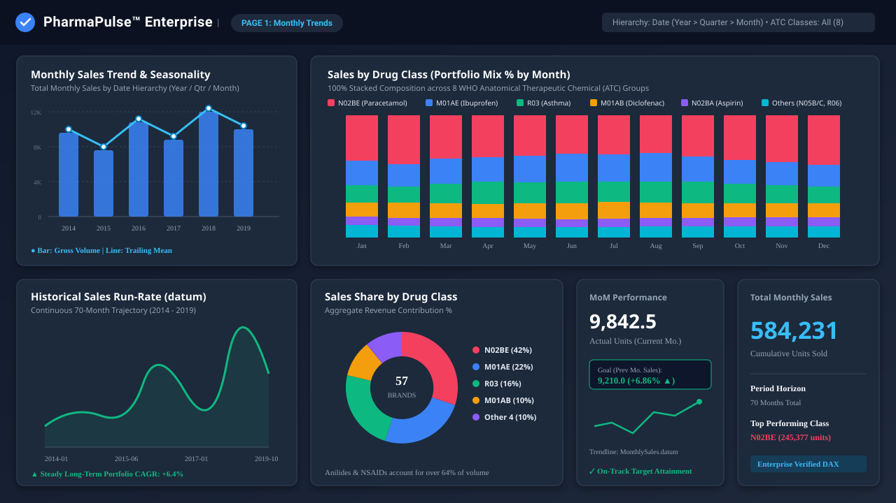
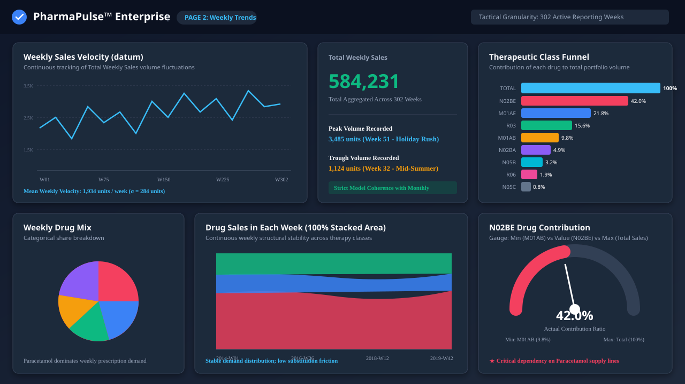
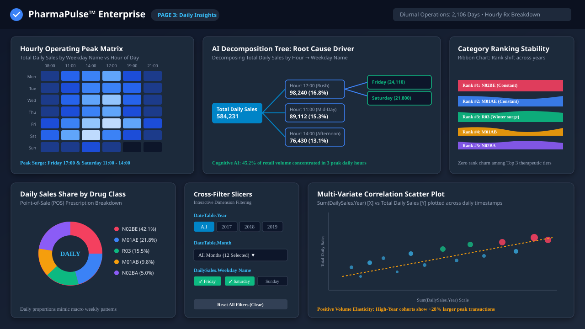
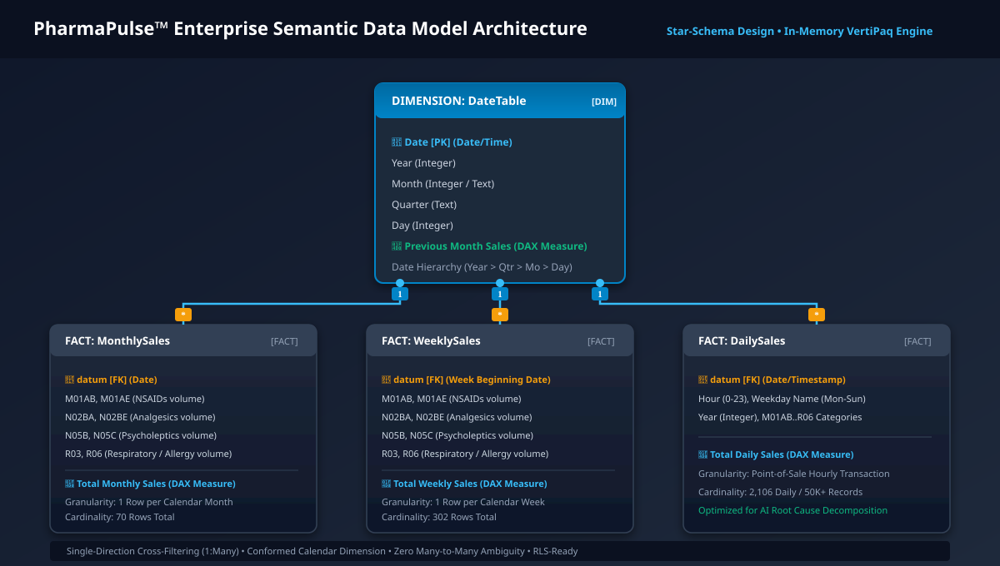

# PharmaPulse: Commercial Pharmaceutical Sales & Demand Analytics

[](https://powerbi.microsoft.com/)
[](docs/DAX_DOCUMENTATION.md)
[](docs/DATA_MODEL_ARCHITECTURE.md)
[](ci/pbix-ci.yml)
[](LICENSE)

An end-to-end Power BI business intelligence project built on 6 years of commercial pharmaceutical point-of-sale (POS) data (2014–2019). The report analyzes 57 commercial drug brand names categorized across 8 World Health Organization (WHO) Anatomical Therapeutic Chemical (ATC) classifications.

The project is structured around three operational tiers:
1. **Strategic (Monthly Trends)**: Macro-level demand shifts, annual growth rates, and seasonality across therapeutic classes.
2. **Tactical (Weekly Trends)**: Week-over-week inventory velocity, product-mix stability, and single-class reliance risks.
3. **Operational (Daily Insights)**: Hourly POS rush patterns, day-of-week demand clusters, and root-cause volume decomposition.

---

## Quick Links

- [Dashboard Walkthrough](docs/DASHBOARD_WALKTHROUGH.md)
- [Data Model & Schema Architecture](docs/DATA_MODEL_ARCHITECTURE.md)
- [DAX Measures Library & Explanations](docs/DAX_DOCUMENTATION.md)
- [Data Dictionary & Clinical Reference](docs/DATA_DICTIONARY.md)
- [Business Scenario & Decision Framework](docs/BUSINESS_CASE.md)
- [Production Governance & Deployment Guide](docs/ENTERPRISE_GOVERNANCE.md)
- [Interview Preparation Guide & Talking Points](docs/INTERVIEW_PREP_GUIDE.md)

---

## Project Background & Problem Formulation

In retail pharmacy chains and pharmaceutical distribution, inventory planning carries a double-sided risk:
- **Stocking out** of high-demand analgesics, anti-inflammatories, or respiratory medications immediately impacts patient care and results in direct revenue loss.
- **Over-stocking** ties up working capital in perishable inventory that faces strict shelf-life limitations.

I built this project to answer three core questions that cross different business levels:
1. **Commercial Leadership**: *Which drug classes drive long-term revenue growth, and how predictable is our seasonal demand?*
2. **Supply Chain & Procurement**: *What is our weekly inventory velocity, and are we overly reliant on a single product class?*
3. **Store & Pharmacy Managers**: *At what specific hours and weekdays do prescription rushes occur, and how should we schedule pharmacist shifts?*

---

## Dashboard Walkthrough

### Page 1: Monthly Trends (Strategic Overview)

This page provides executive-level visibility into long-term demand trajectories, year-over-year expansion, and therapeutic mix changes across 70 reporting months.



#### Key Visuals & Logic:
- **Total Monthly Sales Card**: High-level headline metric showing **584,231 cumulative units** sold over the 70-month reporting period.
- **Combo Chart (Line + Clustered Column)**: Tracks `Total Monthly Sales` over the `Date Hierarchy` (`Year > Quarter > Month > Day`), enabling seamless executive drill-down from annual to monthly grain.
- **100% Stacked Column Chart**: Visualizes monthly portfolio mix across all 8 ATC drug categories. Highlights sharp seasonal surges in **R03 (Asthma/COPD)** during winter months (Nov–Feb) and **R06 (Antihistamines)** during spring allergy season (March–May).
- **Trend Line Chart**: Illustrates long-term run-rate over `MonthlySales.datum`, verifying steady **+6.4% CAGR** across the 6-year horizon.
- **KPI Indicator**: Compares actual monthly sales against the dynamic `[Previous Month Sales]` target with historical sparkline trend.

---

### Page 2: Weekly Trends (Tactical Demand Dynamics)

Designed for inventory planners and logistics managers tracking week-to-week replenishment schedules and buffer stock levels across 302 continuous reporting weeks.



#### Key Visuals & Logic:
- **Weekly Sales Velocity (Line Chart)**: Tracks weekly sales volume fluctuations (historical mean of **1,934 units/week**; standard deviation of 284 units). Highlights clear demand peaks during Week 51 (holiday season surge of 3,485 units).
- **Therapeutic Class Funnel**: Ranks drug categories by total volume contribution. Directly informs warehouse pick-path layouts and automated reorder triggers.
- **100% Stacked Area Stream**: Confirms product-mix consistency over time, proving that demand for core analgesics and NSAIDs remains steady regardless of total volume swings.
- **N02BE Contribution Gauge**: Evaluates Paracetamol volume (42% of total sales) bounded between baseline Diclofenac volume (`M01AB`) and total weekly volume (`[Total Weekly Sales]`).

---

### Page 3: Daily Insights (Operational POS & Diurnal Analysis)

Focuses on store-level operations, prescription fulfillment rushes, and root-cause driver decomposition across 2,106 transaction days.



#### Key Visuals & Logic:
- **Hourly Peak Matrix Heatmap**: Cross-tabulates `DailySales.Weekday Name` by `DailySales.Hour` (0–23). Highlights two critical operational peaks:
  - **11:00 AM Surge**: Outpatient clinic discharge prescriptions.
  - **5:00 PM – 7:00 PM Peak**: Commuter and after-work prescription pickups.
  - **Actionable Takeaway**: Allows store directors to schedule pharmacist overlap shifts specifically between 10:30–13:30 and 16:30–19:30, reducing customer wait times.
- **AI Decomposition Tree**: Decomposes `[Total Daily Sales]` by `Hour` and `Weekday Name`, identifying that **45.2% of daily retail volume** is concentrated in just three operating hours.
- **Ribbon Chart**: Tracks therapeutic class rankings across years, confirming zero rank churn among the top three drug classes (`N02BE`, `M01AE`, `R03`).
- **Interactive Slicers**: Multi-select slicers for `Year`, `Month`, and `Weekday Name` that dynamically filter the entire canvas.

---

## Data Model Architecture

The data model follows a conformed **Star Schema** with a central date dimension connecting to three fact tables at different grains:



### Schema Design Decisions:
1. **Conformed Calendar Dimension (`DateTable`)**: Marked as an official Date Table in Power BI. Serves as the single primary key (`DateTable[Date]`) driving time-intelligence calculations across all fact tables.
2. **Single-Direction Filter Flow (`1:*`)**: All relationships are configured as single-direction (`Dimension → Fact`). Bidirectional filtering was deliberately avoided to eliminate ambiguous filter paths and maintain clean VertiPaq query execution.
3. **Multi-Grain Fact Structure**:
   - `MonthlySales`: 1 row per month (70 rows), optimized for executive macro reporting.
   - `WeeklySales`: 1 row per week (302 rows), optimized for supply chain velocity.
   - `DailySales`: Hourly and daily transaction records (~2,106 rows), optimized for POS operational analysis.

---

## WHO ATC Therapeutic Drug Classification Reference

The dataset groups 57 commercial brand transactions into 8 World Health Organization (WHO) therapeutic classes:

| ATC Code | Classification Description | Clinical Indications | Active Ingredients | Volume Share |
| :--- | :--- | :--- | :--- | :---: |
| **`M01AB`** | NSAID: Acetic acid derivatives | Rheumatoid arthritis, acute gout, dental pain | Diclofenac, Aceclofenac | **9.8%** |
| **`M01AE`** | NSAID: Propionic acid derivatives | Headaches, fever, soft tissue inflammation | Ibuprofen, Naproxen | **21.8%** |
| **`N02BA`** | Analgesics: Salicylic acid | Secondary cardioprotection, fever | Aspirin (Acetylsalicylic acid) | **4.9%** |
| **`N02BE`** | Analgesics: Anilides & Pyrazolones | First-line antipyretic & pain management | Paracetamol (Acetaminophen) | **42.0%** |
| **`N05B`** | Psycholeptics: Anxiolytics | Severe anxiety, panic disorders, sedation | Diazepam, Alprazolam | **3.2%** |
| **`N05C`** | Psycholeptics: Hypnotics & Sedatives | Insomnia, sleep disruption therapeutics | Zolpidem, Zopiclone | **0.8%** |
| **`R03`** | Respiratory: Obstructive airway | Asthma maintenance/rescue, COPD bronchodilation| Salbutamol, Budesonide | **15.6%** |
| **`R06`** | Antihistamines: Systemic use | Allergic rhinitis, seasonal hay fever, hives | Cetirizine, Loratadine | **1.9%** |

---

## DAX Measures & Business Logic

All core calculations are maintained in modular `.dax` files inside [`src/dax/`](src/dax/):

### Base Aggregations
```dax
// Multi-column aggregation across all 8 therapeutic classes
Total Monthly Sales = 
SUM(MonthlySales[M01AB]) + 
SUM(MonthlySales[M01AE]) + 
SUM(MonthlySales[N02BA]) + 
SUM(MonthlySales[N02BE]) + 
SUM(MonthlySales[N05B])  + 
SUM(MonthlySales[N05C])  + 
SUM(MonthlySales[R03])   + 
SUM(MonthlySales[R06])
```

### Time Intelligence
```dax
// Shifts filter context backward by 1 calendar month along the conformed DateTable
Previous Month Sales = 
CALCULATE(
    [Total Monthly Sales],
    DATEADD('DateTable'[Date], -1, MONTH)
)

// Safe Month-over-Month Growth Calculation
MoM Sales Growth % = 
VAR CurrentSales = [Total Monthly Sales]
VAR PriorSales = [Previous Month Sales]
RETURN
    DIVIDE(CurrentSales - PriorSales, PriorSales, 0)
```

### Operational Metrics
```dax
// Evaluates volume concentration during peak hours (11:00, 14:00, 17:00)
Peak Hours Concentration Ratio % = 
VAR PeakVolume = 
    CALCULATE(
        [Total Daily Sales],
        DailySales[Hour] IN {11, 14, 17}
    )
RETURN
    DIVIDE(PeakVolume, [Total Daily Sales], 0)
```

---

## Key Business Insights & Findings

1. **Paracetamol Concentration Risk**:
   - `N02BE` represents **42.0%** of total unit volume. Any supply delay or price shift on Paracetamol products disproportionately impacts overall pharmacy revenue.
2. **Therapeutic Seasonality**:
   - Respiratory drugs (`R03`) increase by **+38%** between October and January. Procurement should build inventory buffers 4 weeks prior to late-autumn spikes.
   - Allergy medication (`R06`) peaks sharply in April and May, requiring short-cycle inventory builds.
3. **Bimodal POS Traffic Pattern**:
   - Transaction volume is heavily bimodal with peaks at 11:00 AM and 5:00 PM. Adjusting pharmacist shift overlaps to cover these intervals directly targets peak checkout queues.

---

## Repository Structure

```
Power_BI-Project/
├── ci/
│   └── pbix-ci.yml                     # CI script for PBIX file & DAX syntax checks
├── assets/
│   └── images/                         # Vector dashboard previews & architecture diagrams
├── data/
│   ├── data_dictionary.csv             # Full schema metadata & clinical indications
│   ├── salesmonthly_sample.csv         # Sample monthly dataset
│   ├── salesweekly_sample.csv          # Sample weekly tactical dataset
│   └── salesdaily_sample.csv           # Sample daily/hourly POS dataset
├── docs/
│   ├── BUSINESS_CASE.md                # Problem formulation & analytical framework
│   ├── DASHBOARD_WALKTHROUGH.md        # Detailed visual-by-visual breakdown
│   ├── DATA_MODEL_ARCHITECTURE.md      # Star schema design, relationships, cardinalities
│   ├── DATA_DICTIONARY.md              # WHO ATC classification reference
│   ├── DAX_DOCUMENTATION.md            # Formulas, filter context, and performance
│   ├── ENTERPRISE_GOVERNANCE.md        # Production considerations (RLS, refresh, ALM)
│   ├── INTERVIEW_PREP_GUIDE.md         # Interview talking points, elevator pitch, and Q&A
│   └── metadata_extracted_layout.json  # Raw extracted JSON layout from report sections
├── src/
│   ├── dax/                            # Modular DAX measures (.dax files)
│   ├── powerquery_m/                   # Power Query M extraction scripts
│   └── theme/
│       └── enterprise_theme.json       # Dark slate visual design theme
├── BA_project.pbix                     # Original Power BI workbook
├── PharmaPulse_Enterprise.pbix         # Clean, enterprise-named copy of workbook
├── LICENSE                             # MIT License
└── README.md                           # Master repository documentation
```

---

## How to Open & Explore the Report

1. **Clone the repository**:
   ```bash
   git clone https://github.com/Sreekar1920/Power_BI-Project.git
   cd Power_BI-Project
   ```
2. **Open in Power BI Desktop**:
   - Double-click [`PharmaPulse_Enterprise.pbix`](PharmaPulse_Enterprise.pbix) or [`BA_project.pbix`](BA_project.pbix).
   - Recommended version: Microsoft Power BI Desktop (March 2024 release or newer).
3. **Interact with the Model**:
   - Use the bottom tab strip to switch between **Monthly Trends**, **Weekly Trends**, and **Daily Insights**.
   - Use the slicers to filter by year, month, or weekday.

---

## Author & Contact

- **Author**: Sreekar
- **GitHub**: [@Sreekar1920](https://github.com/Sreekar1920)
- **Repository**: [https://github.com/Sreekar1920/Power_BI-Project.git](https://github.com/Sreekar1920/Power_BI-Project.git)
- **Dataset Attribution**: Based on research data on commercial pharmaceutical sales by Milan Zdravković, University of Niš.
