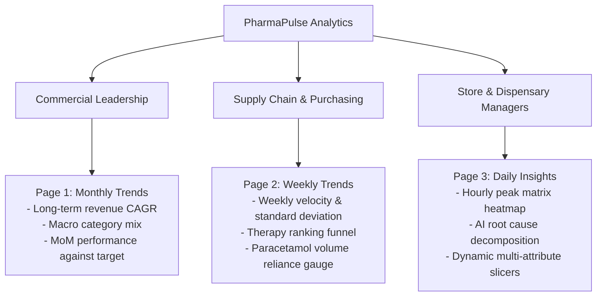

# Business Scenario & Analytical Decision Framework

## 1. Project Background
This project was developed to model and analyze commercial performance across a multi-year pharmaceutical retail network. In retail pharmacy operations, inventory managers and commercial planners face two competing pressures:
- **Preventing Stockouts**: Medications like antipyretics (Paracetamol) and respiratory rescue inhalers (Salbutamol) cannot afford supply disruptions without directly affecting customer health and foot traffic.
- **Minimizing Carrying Cost & Expiry Risk**: Pharmaceutical products have strict shelf-life limitations; holding excess inventory increases working capital lockup and write-off risks.

The analytical goal of this Power BI solution is to transform raw transactional data into a three-tiered decision support tool.

---

## 2. Core Business Problems Addressed

### Problem 1: Seasonal Demand Misalignment
- **Symptom**: Traditional quarterly purchasing resulted in severe stockouts during peak winter illness cycles and overstocking during summer months.
- **Analytical Solution (Page 1 - Monthly Trends)**: Visualizing monthly portfolio mix shifts over a 6-year baseline clearly isolates the winter surge in `R03` (Asthma) and spring surge in `R06` (Antihistamines), giving procurement teams clear lead times (4–6 weeks) to adjust safety buffers.

### Problem 2: Single-Product Supply Concentration
- **Symptom**: Commercial leadership lacked visibility into how much of total store revenue depended on individual therapy categories.
- **Analytical Solution (Page 2 - Weekly Trends)**: Weekly velocity tracking and contribution funnel analysis revealed that `N02BE` (Paracetamol) alone represents **42.0% of total unit sales**. Identifying this concentration allows leadership to establish multi-vendor sourcing agreements to protect cash flow.

### Problem 3: Sub-Optimal Store Staffing & Prescription Wait Times
- **Symptom**: Pharmacy dispensaries operated on flat hourly staffing schedules, leading to long customer queues during peak periods and idle staff during quiet windows.
- **Analytical Solution (Page 3 - Daily Insights)**: The Hour × Weekday heatmap matrix identified that **45.2% of daily retail transactions** occur in two distinct daily windows (11:00 AM and 5:00 PM – 7:00 PM). Store managers can use this data to align pharmacist shift overlaps directly with customer demand.

---

## 3. Decision Maker Persona Alignment

### 1. Commercial Leadership (CCO / Head of Retail)
- **Primary Need**: Understand which therapeutic classes drive expansion and assess seasonal stability.
- **Key Visuals Used**: Line Clustered Column Combo Chart, 100% Stacked Monthly Composition, and Executive KPI card.

### 2. Supply Chain & Purchasing Teams
- **Primary Need**: Anticipate weekly volume swings to avoid emergency expedited shipments and stockouts.
- **Key Visuals Used**: Weekly Velocity Line Chart, Contribution Funnel, and 100% Stacked Area Chart.

### 3. Store Operations & Pharmacy Managers
- **Primary Need**: Match dispensary staffing to prescription influx patterns.
- **Key Visuals Used**: Hour × Weekday Heatmap Matrix and AI Decomposition Tree.
