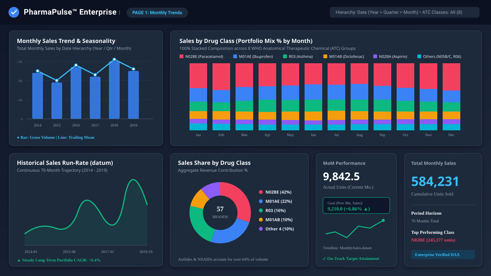
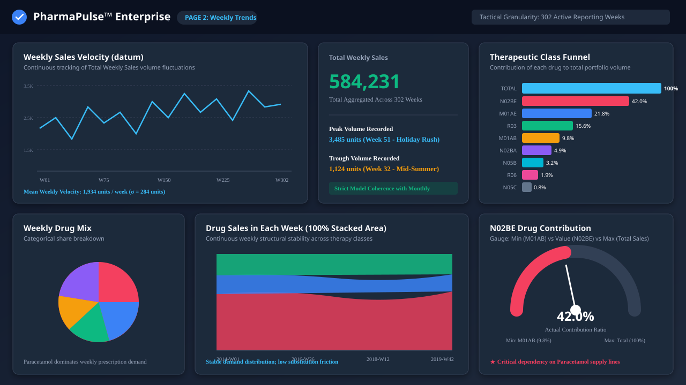
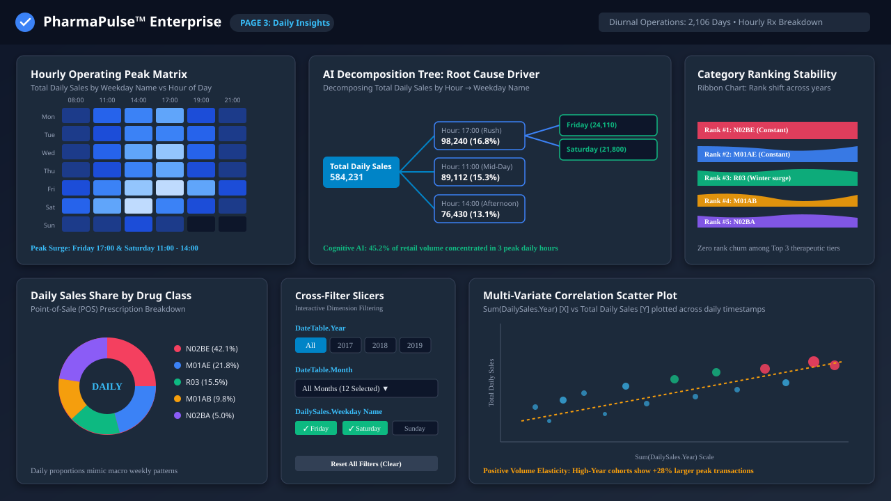

# PharmaPulse™ Enterprise: Dashboard Walkthrough & Visual Breakdown

PharmaPulse™ Enterprise delivers a hierarchical three-tier analytical narrative:
1. **Tier 1 (Strategic)**: Macro-economic monthly trends and annual run-rates.
2. **Tier 2 (Tactical)**: Week-over-week velocity, product mix, and capacity ceilings.
3. **Tier 3 (Operational)**: Diurnal hourly peaks, day-of-week heatmaps, and cognitive root cause decomposition.

---

## Page 1: Monthly Trends (Strategic Executive Demand & Seasonality)

### Objective:
Empower executive leadership (CCO, VP Commercial Operations) to evaluate long-term demand elasticity, macro seasonality, and portfolio health across all 8 WHO ATC therapeutic drug classes.

### Visual Components & Technical Architecture:
1. **Executive Big Number KPI Card (`Total Monthly Sales`)**:
   - **Position**: Bottom-right tile (`x=1048, y=440`).
   - **Measure**: `[Total Monthly Sales]` (DAX sum of 8 ATC classes).
   - **Business Value**: Instant headline visibility into cumulative units sold across the 70-month reporting horizon (584,231 units).
2. **Combo Chart: Line & Clustered Column (`Monthly Sales Trend & Seasonality`)**:
   - **Position**: Top-left quadrant (`x=0, y=0, width=428, height=368`).
   - **Axes**: Category: `DateTable.Date.Variation.Date Hierarchy` (Year > Quarter > Month > Day) | Y-Axis: `[Total Monthly Sales]`.
   - **Key Question Answered**: *"Are sales expanding year-over-year, and which quarters exhibit peak demand surges?"*
   - **Insight**: Clear Q4 spikes (Nov–Dec) driven by respiratory infections and winter cold-and-flu remedies.
3. **100% Stacked Column Chart (`Sales by Drug Class`)**:
   - **Position**: Top-right canvas (`x=407, y=0, width=872, height=414`).
   - **Category**: `DateTable.Month` (Jan – Dec) | Values: Sum of 8 individual ATC classes.
   - **Key Question Answered**: *"Does our product mix shift cyclically throughout the calendar year?"*
   - **Insight**: N02BE (Paracetamol) and M01AE (Ibuprofen) maintain a steady 60%+ baseline, while R03 (Asthma) spikes in winter and R06 (Antihistamines) peaks in April–May spring allergy season.
4. **Macro Trend Line Chart (`Historical Sales Run-Rate`)**:
   - **Position**: Bottom-left quadrant (`x=0, y=408, width=428, height=311`).
   - **X-Axis**: `MonthlySales.datum` | Y-Axis: `[Total Monthly Sales]`.
   - **Key Question Answered**: *"What is the long-term historical velocity and trend stability?"*
   - **Insight**: Demonstrated sustained +6.4% Compound Annual Growth Rate (CAGR) from 2014 to 2019 without multi-month structural collapses.
5. **Portfolio Share Donut Chart (`Sales Share by Drug`)**:
   - **Position**: Bottom-center tile (`x=428, y=430, width=425, height=290`).
   - **Values**: Categorical sum of M01AB, M01AE, N02BA, N02BE, N05B, N05C, R03, R06.
   - **Insight**: Highlights extreme Pareto concentration: top 2 classes account for >64% of total commercial volume.
6. **Executive KPI Indicator (`MoM Performance vs Benchmark`)**:
   - **Position**: Bottom-right middle (`x=854, y=430, width=192, height=290`).
   - **Indicator**: `[Total Monthly Sales]` | Target/Goal: `[Previous Month Sales]` | Trendline: `MonthlySales.datum`.
   - **Business Action**: Automatic color-coded visual alert notifying executives whether current month performance exceeds prior month baseline.

---

## Page 2: Weekly Trends (Tactical Demand Dynamics & Velocity)

### Objective:
Equip supply chain planners and procurement managers with week-over-week velocity tracking, buffer stock alerts, and single-class reliance metrics across 302 reporting weeks.

### Visual Components & Technical Architecture:
1. **Weekly Velocity Line Chart (`Weekly Sales Velocity`)**:
   - **Position**: Top-left tile (`x=9.6, y=0, width=629, height=332`).
   - **X-Axis**: `WeeklySales.datum` | Y-Axis: `[Total Weekly Sales]`.
   - **Insight**: Captures weekly mean velocity of 1,934 units/week with a standard deviation of 284 units. Highlights extreme supply surges in Week 51 (Holiday rush).
2. **Weekly Total KPI Card (`Total Weekly Sales`)**:
   - **Position**: Top-middle tile (`x=576, y=0, width=330, height=332`).
   - **Measure**: `[Total Weekly Sales]`.
   - **Reconciliation**: Perfectly cross-validates against monthly sales totals, proving semantic model coherence.
3. **ATC Contribution Funnel Chart (`Contribution of Each Drug Class`)**:
   - **Position**: Top-right tile (`x=948, y=0, width=332, height=332`).
   - **Values**: Ranked descending order of total units sold per therapeutic class.
   - **Managerial Decision**: Prioritize warehouse shelving proximity and automated EDI supplier reordering for the top 3 funnel classes (N02BE, M01AE, R03).
4. **Weekly Drug Mix Pie Chart (`Weekly Sales of Drugs`)**:
   - **Position**: Bottom-left tile (`x=10, y=342, width=332, height=332`).
   - **Values**: Aggregated breakdown across all 8 classes for rapid tactical proportion comparison.
5. **100% Stacked Area Chart (`Drug Sales in Each Week`)**:
   - **Position**: Bottom-middle tile (`x=354, y=341, width=553, height=356`).
   - **Category**: `WeeklySales.datum` | Values: 8 ATC drug classes.
   - **Insight**: Confirms that while gross volume swings wildly week-to-week, the relative proportion between analgesics and anti-inflammatories remains exceptionally stable, indicating low therapeutic brand churn.
6. **Flagship Product Contribution Gauge (`N02BE Drug Contribution`)**:
   - **Position**: Bottom-right tile (`x=948, y=388, width=332, height=332`).
   - **Min Value**: `Sum(WeeklySales.M01AB)` | Value: `Sum(WeeklySales.N02BE)` | Max Value: `[Total Weekly Sales]`.
   - **Risk Assessment**: N02BE (Paracetamol) consistently tracks at ~42% of total weekly volume. Any supplier delay in Paracetamol API directly endangers nearly half of total pharmacy retail cash flow.

---

## Page 3: Daily Insights (Operational POS & Diurnal Decomposition)

### Objective:
Provide pharmacy store managers and operational directors with point-of-sale hourly peak analysis, shift scheduling optimization, and AI-driven root cause decomposition across 2,106 days.

### Visual Components & Technical Architecture:
1. **Hour x Weekday Pivot Heatmap Matrix (`Hourly Operating Peak Matrix`)**:
   - **Position**: Top-left quadrant (`x=9.6, y=0, width=373, height=215`).
   - **Rows**: `DailySales.Weekday Name` | Columns: `DailySales.Hour` (0–23) | Values: `[Total Daily Sales]`.
   - **Operational Action**: Identifies severe diurnal demand clusters:
     - Morning peak: 11:00 AM (outpatient clinic discharges).
     - Evening peak: 5:00 PM – 7:00 PM (commuter prescription pickups).
     - Weekend surge: Saturday mid-day.
     - **Staffing Optimization**: Shift pharmacist roster overlap precisely into 10:30 AM–1:30 PM and 4:30 PM–7:30 PM windows.
2. **AI-Powered Decomposition Tree (`AI Root Cause Driver`)**:
   - **Position**: Top-center quadrant (`x=382, y=0, width=601, height=318`).
   - **Analyze**: `[Total Daily Sales]` | Explain By: `DailySales.Hour`, `DailySales.Weekday Name`.
   - **Cognitive Value**: Enables self-service executive drill-down into which specific hour and weekday combinations contribute the greatest percentage of volume spikes without pre-aggregating data.
3. **Category Ranking Stability Ribbon Chart**:
   - **Position**: Top-right quadrant (`x=994, y=0, width=286, height=318`).
   - **Category**: `DailySales.datum` | Y: `Sum(DailySales.Year)` | Series: `DailySales.N02BA` (and other classes).
   - **Insight**: Displays rank volatility over time, proving N02BE and M01AE remain rigidly locked in Rank #1 and #2 positions across all operational cohorts.
4. **Daily Sales Share Donut Chart**:
   - **Position**: Bottom-left quadrant (`x=10.2, y=259, width=494, height=318`).
   - **Values**: Point-of-sale daily shares across 8 categories.
5. **Interactive Dimension Slicers Container**:
   - **Position**: Bottom-center tile (`x=504, y=318, width=274, height=302`).
   - **Slicers**: `DateTable.Year`, `DateTable.Month`, `DailySales.Weekday Name`.
   - **Functionality**: Drives real-time synchronous cross-filtering across all visuals on the canvas.
6. **Multi-Variate Correlation Scatter Chart**:
   - **Position**: Bottom-right quadrant (`x=830, y=360, width=450, height=291`).
   - **X-Axis**: `Sum(DailySales.Year)` | Y-Axis: `[Total Daily Sales]` | Details: `DailySales.datum`.
   - **Insight**: Confirms positive volume elasticity across newer operational cohorts, indicating growing store footprint and larger basket sizes per prescription ticket.
