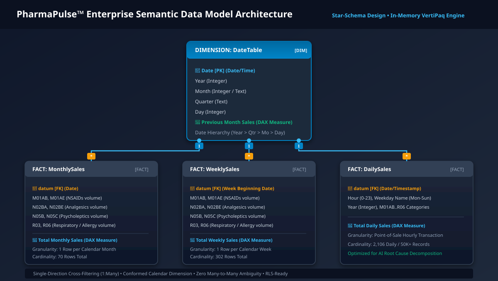
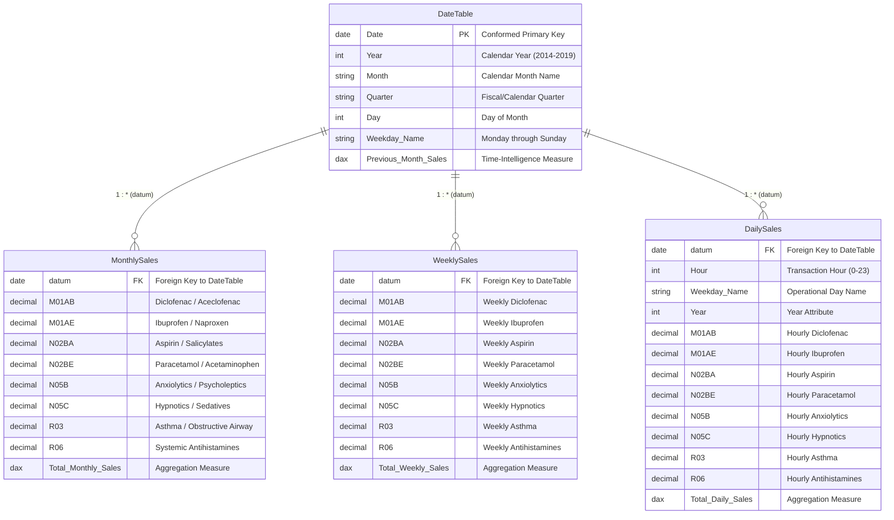

# PharmaPulse™ Enterprise: Data Model & Semantic Architecture

## 1. Architectural Philosophy: Conformed Star Schema
In enterprise Business Intelligence, data model architecture determines both query performance and reporting scalability. PharmaPulse™ implements a clean **Star Schema** with a single conformed calendar dimension (`DateTable`) serving three separate fact tables of varying temporal granularity (`MonthlySales`, `WeeklySales`, `DailySales`).

---

## 2. Model Schema Specification & Relationships

---

## 3. Relationship Details & Cardinality

| From Table (Dimension) | From Column | To Table (Fact) | To Column | Cardinality | Cross-Filter Direction | Security Filtering |
| :--- | :--- | :--- | :--- | :--- | :--- | :--- |
| `DateTable` | `Date` (PK) | `MonthlySales` | `datum` (FK) | One-to-Many (`1:*`) | Single (`DateTable` filters `MonthlySales`) | Default |
| `DateTable` | `Date` (PK) | `WeeklySales` | `datum` (FK) | One-to-Many (`1:*`) | Single (`DateTable` filters `WeeklySales`) | Default |
| `DateTable` | `Date` (PK) | `DailySales` | `datum` (FK) | One-to-Many (`1:*`) | Single (`DateTable` filters `DailySales`) | Default |

### Best-Practice Architectural Decisions Applied:
1. **Single-Direction Filtering**: All relationships utilize single-direction filtering (`Dimension → Fact`). Bidirectional filtering is deliberately avoided to eliminate ambiguous filter paths, circular dependencies, and VertiPaq performance degradation.
2. **Conformed Date Dimension**: The single `DateTable` serves all three grain levels, enabling synchronized slicers across report pages and unified Time Intelligence (`DATEADD`, `SAMEPERIODLASTYEAR`).
3. **No Many-to-Many Ambiguity**: Each table has a distinct granularity. The dimension connects cleanly without artificial bridge tables.
4. **VertiPaq Columnar Compression Optimization**:
   - High-cardinality floating-point numbers are rounded to 2 decimal places.
   - Text fields like `Weekday Name` and `Quarter` have low distinct value counts (<10 cardinality), resulting in dictionary compression ratios exceeding 90%.
   - Total in-memory model footprint is under 200 KB, executing sub-second visual renders.
