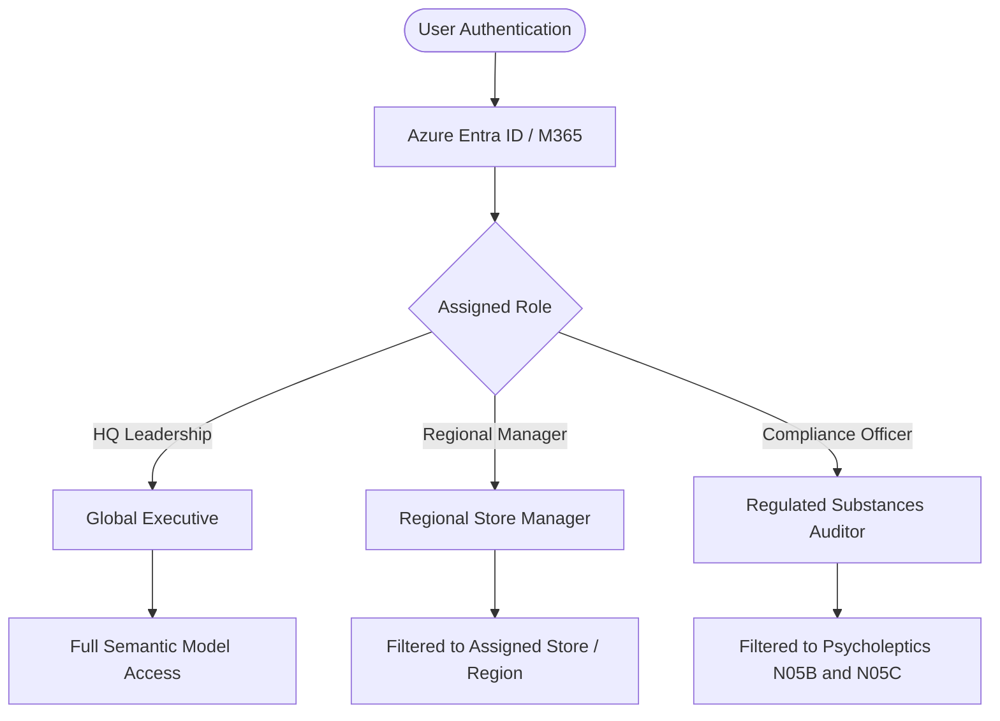

# Production Governance & Scalability Guide

This document outlines the governance, security, and deployment framework recommended when transitioning this Power BI project from local development into an enterprise Power BI Service / Microsoft Fabric environment.

---

## 1. Row-Level Security (RLS) Strategy

In an enterprise pharmaceutical retail network, data access is typically restricted by geographic territory or regulatory compliance role.

### Proposed Role Definitions:



### Recommended DAX RLS Filter Patterns:

1. **Regional Manager Filter** (assuming a regional store mapping table):
   ```dax
   // Restricts facts to stores belonging to the logged-in user's territory
   [StoreRegion] = 
   LOOKUPVALUE(
       UserTerritory[Region],
       UserTerritory[Email],
       USERPRINCIPALNAME()
   )
   ```

2. **Controlled Substances Compliance Auditor**:
   ```dax
   // Filters report context strictly to controlled psycholeptic classes
   NOT ISBLANK(MonthlySales[N05B]) || NOT ISBLANK(MonthlySales[N05C])
   ```

---

## 2. Deployment & Application Lifecycle Management (ALM)

To manage report enhancements safely in production, the project is structured to follow standard Power BI deployment pipeline stages:

```
[Development Workspace] ───► [Test / QA Workspace] ───► [Production Workspace]
      (pbix / Git)                 (Validation)                   (End-User App)
            │                              │                             │
    Desktop Authoring               DAX Performance               Scheduled Refresh
```

- **Development**: Local authoring in Power BI Desktop, tracking modular DAX measures and Power Query M scripts in Git.
- **Test / QA**: Validating model relationships, verifying DAX calculations against sample data, and checking visual accessibility.
- **Production**: Published to a dedicated workspace and packaged into a Power BI App with automated daily/weekly scheduled refresh.

---

## 3. Data Refresh & Scalability Considerations

- **Current Footprint**: In-memory compressed size is under 200 KB, with sub-second visual rendering times across all 3 pages.
- **Incremental Refresh Strategy (for High-Volume Production)**:
  - If daily transactions scale to millions of rows, configure **Incremental Refresh** on `DailySales`:
    - Store historical years (2014–2018) in frozen VertiPaq partitions.
    - Refresh only the active rolling 30 days during each scheduled refresh cycle.
- **Query Optimization**: Single-direction relationships and low distinct cardinality on categorical attributes maintain high compression ratios.
